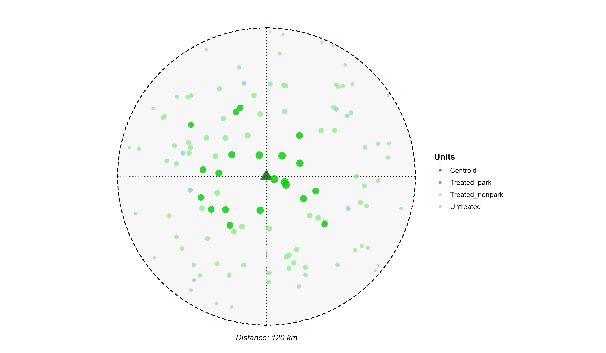
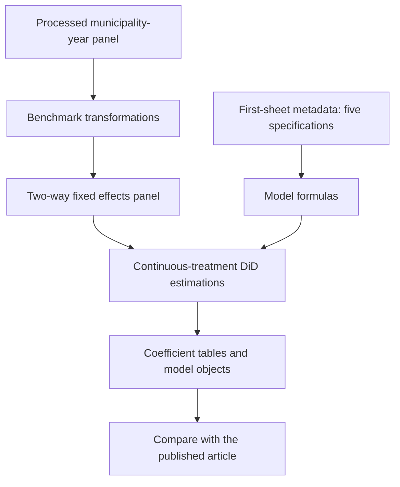

# Protected Areas and Income in Italian Inner Areas — Replication Package

<p align="center">
  
</p>

Replication material associated with:

**Do Protected Areas Affect the Income Levels in Remote Regions? Evidence from Italian Inner Areas**

**Authors:** Gianluca Monturano, Carmela Ciccarelli, and Luigi Mastronardi  
**Journal:** *Environmental and Resource Economics*, Volume 89, Article 76 (2026)  
**Published article:** https://link.springer.com/article/10.1007/s10640-026-01122-0  
**DOI:** https://doi.org/10.1007/s10640-026-01122-0  
**Repository:** https://github.com/gmonturano/enviromental_income_park

## Overview

This repository documents the main two-way fixed-effects Difference-in-Differences (DiD) specifications accompanying the paper. The analysis studies how the share of municipal land under environmental protection relates to per-capita income in Italian inner municipalities, within the place-based policy context of the National Strategy for Inner Areas (SNAI).

The public repository focuses on the principal estimations. It does not bundle every raw-source download, exploratory script, geographic-processing routine, event study, or heterogeneity analysis employed throughout the research project.

## Empirical approach

The benchmark estimates use a continuous treatment: **the share of municipal surface designated as protected area**. The authors compare changes before and after the 2014 policy transition, controlling for municipal and year fixed effects. Five principal specifications are defined in the first worksheet of the supplied metadata workbook; successive models use different sets of socioeconomic and policy controls.

The full article also discusses event-study evidence, territorial spillovers, heterogeneity, and distributional outcomes. Those analyses are not part of the main-script release here.

## Replication workflow



## Repository structure

```text
enviromental_income_park/
├── README.md
├── cover.png
├── code/
│   ├── 01_main_did.R
│   └── meta_DB_Turi_spec_2007_2020.xlsx
├── db/
│   └── db_TOT_aree_prot.RData
└── results/
    └── tables/
```

## Data availability

All data employed in the study come from official statistical sources that are publicly available and can be freely downloaded. The dataset construction process can be replicated using the data sources described in the published article. Additional information about data preparation and direct source links can be obtained from the authors upon request.

The repository includes the author's processed RData input (`db/db_TOT_aree_prot.RData`) from the supplied archive, rather than every raw input file. **This file is the full supplied processed RData, not a 100-row sample.** Releasing this file should be confirmed against the authors' redistribution preferences before making the repository public.

The RData file must contain the object `DB_finale`, required for the benchmark analysis. Published coefficients are authoritative only in the published article; different processed-data revisions can yield different outputs.

## Metadata

The workbook `code/meta_DB_Turi_spec_2007_2020.xlsx` contains **only the first worksheet** (`Foglio1`), which specifies the five benchmark models (`Spec1`–`Spec5`). The metadata labels specify `dependent_var`, `independent_vars`, `interaction` and `control_vars`.

The reported outcome is `Redditi_Procapite` and the key interaction is `Treat:X..Aree.protette`, following the original estimation script. The workflow uses the treatment coding stored in the processed panel rather than creating a replacement intervention variable.

## Main R script

`code/01_main_did.R` implements the five metadata-driven specifications using `plm::plm()` with municipality and time fixed effects. It contains the original benchmark definitions adapted into a single readable file, with project-relative data paths, explicit dependency checks, and machine-readable output exports.

The public code does not include alternate subgroup regressions, exploratory graphs, placebo tests, or spatial estimation blocks.

## Software requirements

R and the R packages `plm` and `readxl` are required. Install missing packages with:

```r
install.packages(c("plm", "readxl"))
```

## How to run

Open R or RStudio in the repository root and execute:

```r
source("code/01_main_did.R")
```

The script loads `DB_finale`, applies the benchmark transformations, reads the first metadata sheet, estimates the five specifications and writes results to `results/tables/`.

### Outputs

- `results/tables/main_coefficients.csv` — numerical coefficient table for the estimated specifications.
- `results/tables/main_models.rds` — serialized fitted model objects for subsequent analysis.

Generated outputs are not supplied as published tables. Please consult the article for official estimates, inference, and interpretation.

## Scope and verification

This package is based on the authors' supplied code, metadata, and processed RData file. The original script was consolidated to retain only the benchmark specifications. The model implementation **has not been executed or numerically validated in R in this environment**. The supplied file may require minor adjustments if its panel object or variable transformations differ from the archived working version.

## Additional code availability

The full set of coding files—including database construction, event-study analyses, territorial heterogeneity, spatial spillover models, alternative specifications and supplementary checks—is available from the authors upon reasonable request.

## Citation

Monturano, G., Ciccarelli, C., & Mastronardi, L. (2026). **Do Protected Areas Affect the Income Levels in Remote Regions? Evidence from Italian Inner Areas.** *Environmental and Resource Economics*, **89**, Article 76. https://doi.org/10.1007/s10640-026-01122-0
