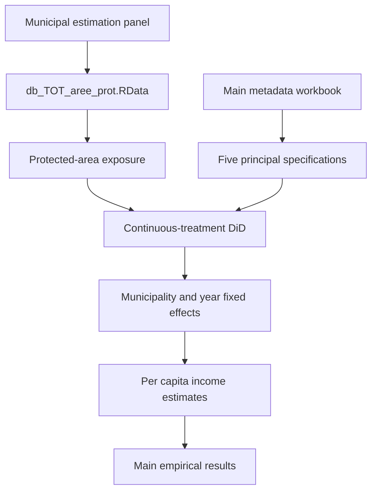

# Protected Areas and Income in Italian Inner Areas — Replication Package

**Published in:** *Environmental and Resource Economics* (Springer Nature), Volume 89, Article 76, 2026.

**DOI:** https://doi.org/10.1007/s10640-026-01122-0

**Published article:** https://link.springer.com/article/10.1007/s10640-026-01122-0

**Authors:** Gianluca Monturano, Carmela Ciccarelli, Luigi Mastronardi.

**Repository:** https://github.com/gmonturano/enviromental_income_park

---

<p align="center">
  
</p>

## About this replication package

This repository accompanies the research article:

**Do Protected Areas Affect the Income Levels in Remote Regions? Evidence from Italian Inner Areas.**

As stated in the published article's Data Availability section, the **main R code used to produce the empirical estimates is made publicly available through this GitHub repository**.

Accordingly, this repository provides the public main-estimation component of the research, rather than the complete computational archive.

The broader replication package, including the original data-preparation routines, supplementary specifications, spatial analyses, and robustness procedures, may be requested from the authors.

**Researchers seeking the full replication package should contact the corresponding author directly by email**, subject to applicable data-sharing conditions.

---

## 1. Overview

The study investigates the economic effects of protected natural areas on income in remote Italian municipalities.

The analysis focuses on territories classified as inner areas under the Italian National Strategy for Inner Areas.

The research examines whether the presence and intensity of protected areas are associated with changes in local economic performance.

The empirical investigation uses municipal panel data covering **2007–2022**.

The principal outcome is municipal per capita income.

The main treatment measures the proportion of municipal land designated as protected.

The econometric framework is based on a **continuous-treatment Difference-in-Differences approach**, incorporating municipal and year fixed effects.

The study assesses whether the effects of protected areas differ across territories and types of protection.

The published paper also reports additional spatial and robustness analyses.

The public repository focuses on the principal metadata-driven DiD estimations.

---

## 2. Scope of public replication

The publicly available repository contains:

- The main R estimation script.
- The metadata workbook defining the principal specifications.
- The processed municipal estimation dataset.
- Documentation of the estimation workflow.
- A representative research figure.

The full research archive may additionally include:

- Original data-source acquisition and harmonization.
- Construction of protected-area exposure measures.
- Municipal geographic matching.
- Alternative treatment definitions.
- Territorial and spatial spillover models.
- Additional heterogeneity analyses.
- Robustness and sensitivity procedures.

These materials may be requested from the corresponding author.

Although the article identifies public statistical sources for the underlying data, the public estimation package does not necessarily include the complete workflow for reconstructing the processed municipal panel from the original sources.

---

## 3. Replication workflow



The workflow represents the main estimation stage.

Additional analyses reported in the published article may require further original code and research materials.

---

## 4. Repository structure

```text
enviromental_income_park/
│
├── code/
│   ├── 01_main_did.R
│   └── meta_DB_Turi_spec_2007_2020.xlsx
│
├── db/
│   └── db_TOT_aree_prot.RData
│
├── results/
│   └── tables/
│
├── cover.png
└── README.md
```

The repository contains the principal DiD estimation script and the metadata required to define the main specifications.

---

## 5. Data availability

The empirical analysis uses municipal panel information concerning:

- Per capita taxable income.
- Protected-area coverage.
- Municipal socioeconomic characteristics.
- Territorial conditions.
- Additional explanatory variables.
- Municipality and year identifiers.

The underlying research draws on official statistical sources described in the published article.

### 5.1 Processed municipal dataset

The repository includes:

```text
db/db_TOT_aree_prot.RData
```

This file contains the processed research panel used by the public main-estimation code.

It is loaded directly by the R script.

The dataset supports inspection of the principal model variables and execution of the metadata-defined DiD specifications, subject to the required software dependencies.

### 5.2 Original data construction

The full preparation of the research panel includes the integration of administrative income information, protected-area indicators, and municipal characteristics.

The complete construction process may require:

- Downloading data from the original sources.
- Geographic harmonization.
- Municipal identifier reconciliation.
- Treatment-intensity construction.
- Variable transformation.
- Panel consistency checks.

The full set of these procedures is not included in the minimal public estimation package.

Additional information concerning data preparation and source access may be requested from the corresponding author.

### 5.3 Full empirical replication

The public processed dataset supports the principal estimation framework.

Reproduction of every published figure, spatial analysis, and robustness result may require additional scripts and supporting materials.

The published article remains the authoritative source for the reported numerical results.

---

## 6. Metadata and econometric specifications

The main specification workbook is:

```text
code/meta_DB_Turi_spec_2007_2020.xlsx
```

The repository contains the relevant first worksheet of the original metadata workbook.

The worksheet defines **five main econometric specifications**.

The principal variables include:

```text
Redditi_Procapite
Treat:X..Aree.protette
```

The first variable represents the income outcome in the processed data.

The second identifies the treatment term associated with protected-area exposure.

The exact model formulas and variable transformations are defined by the metadata and the estimation script.

The general empirical specification can be represented as:

```text
Income_it =
    beta × (Post_t × ProtectedAreaShare_i)
    + Controls_it
    + Municipality fixed effects
    + Year fixed effects
    + Error_it
```

The treatment intensity corresponds to the share of municipal land classified as protected.

The published empirical design uses a post-treatment period beginning in **2014**.

This structure allows the analysis to exploit variation in the intensity of protected-area exposure rather than only a binary treated-versus-untreated distinction.

---

## 7. Main R script

### `code/01_main_did.R`

Implements the principal metadata-driven Difference-in-Differences estimations.

The script:

1. Loads the processed municipal panel.
2. Reads the main metadata workbook.
3. Identifies the treatment and outcome variables.
4. Constructs the required fixed-effects specifications.
5. Estimates the five main DiD models.
6. Produces regression outputs for the selected specifications.

The public script concentrates on the principal municipal panel estimations.

The broader published study contains additional territorial, spatial, and robustness analyses that may not be implemented in the minimal public code.

---

## 8. Software requirements

The empirical analysis was developed in **R**.

The main public script requires:

- `plm` for panel-data estimation.
- `readxl` for reading Excel metadata.

Additional packages may be required for optional statistical reporting or supplementary analyses.

Install the dependencies before running the main code.

RStudio is recommended but not required.

---

## 9. How to run

Clone the repository:

```bash
git clone https://github.com/gmonturano/enviromental_income_park.git
```

Open the repository root in R or RStudio.

Install the required packages if necessary:

```r
install.packages(c("plm", "readxl"))
```

Run the main estimation script:

```r
source("code/01_main_did.R")
```

The script expects:

```text
db/db_TOT_aree_prot.RData
code/meta_DB_Turi_spec_2007_2020.xlsx
```

The public code uses the metadata-defined main specifications.

Successful execution requires the expected panel structure, variable names, and installed dependencies.

---

## 10. Replication outputs

The main estimation script is designed to produce:

- DiD coefficient estimates.
- Fixed-effects regression summaries.
- Standard errors.
- Statistical significance measures.
- Main-model statistical outputs.

The public directory:

```text
results/tables/
```

provides a location for organizing generated estimation tables.

The complete set of published robustness results, spatial exercises, and supplementary figures may require additional computational materials.

The published article remains the official reference for the reported results.

---

## 11. Full replication package — available upon request

**The main R estimation code is publicly available through this repository, consistent with the Data Availability statement of the published article.**

However, this repository does not include the entire computational archive underlying the research.

The broader replication package may include:

- Complete data-construction scripts.
- Original data-source documentation.
- Additional treatment specifications.
- Spatial spillover analyses.
- Territorial heterogeneity estimations.
- Robustness and sensitivity checks.
- Supplementary tables and figures.

**Researchers requiring the full replication package should contact the corresponding author directly by email.**

Requests should identify the article by title or DOI and include a brief description of the intended replication purpose.

Sharing of particular datasets or third-party materials remains subject to their applicable licensing, privacy, and redistribution conditions.

---

## 12. Citation

If you use the public code, metadata, or supporting data, please cite:

Monturano, G., Ciccarelli, C., & Mastronardi, L. (2026).

**Do Protected Areas Affect the Income Levels in Remote Regions? Evidence from Italian Inner Areas.**

*Environmental and Resource Economics, 89*, Article 76.

https://doi.org/10.1007/s10640-026-01122-0

### BibTeX

```bibtex
@article{monturano2026protected,
  title   = {Do Protected Areas Affect the Income Levels
             in Remote Regions?
             Evidence from Italian Inner Areas},
  author  = {Monturano, Gianluca and
             Ciccarelli, Carmela and
             Mastronardi, Luigi},
  journal = {Environmental and Resource Economics},
  volume  = {89},
  pages   = {76},
  year    = {2026},
  doi     = {10.1007/s10640-026-01122-0},
  url     = {https://doi.org/10.1007/s10640-026-01122-0}
}
```

---

## 13. Contact and research inquiries

For questions about the estimation code, metadata, or full replication materials, please contact the corresponding author directly by email.

**Repository scope:** Public main-estimation DiD code and processed municipal panel.

**Full replication package:** Available upon direct email request, subject to applicable data-sharing restrictions.

**Official publication:** https://doi.org/10.1007/s10640-026-01122-0
